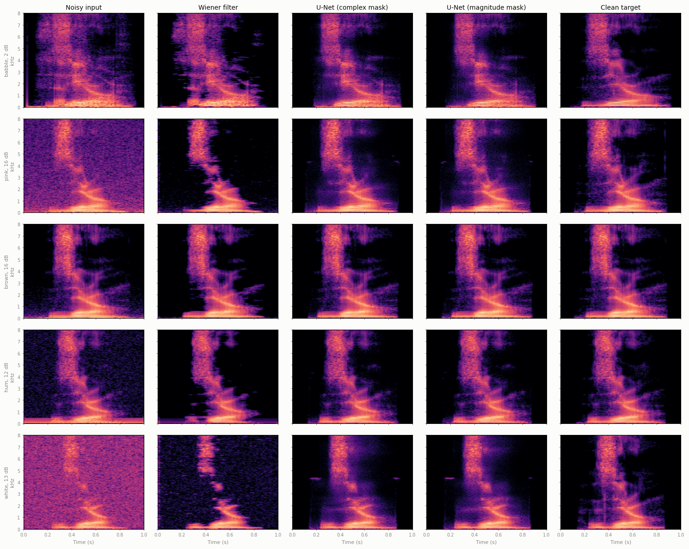
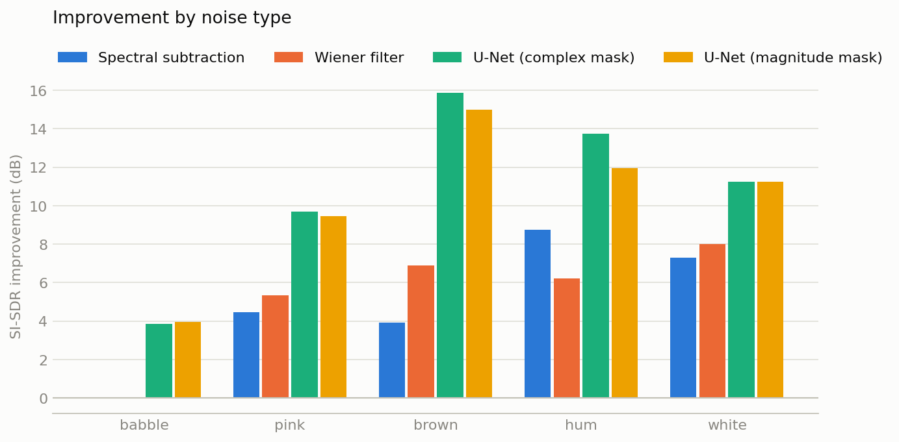
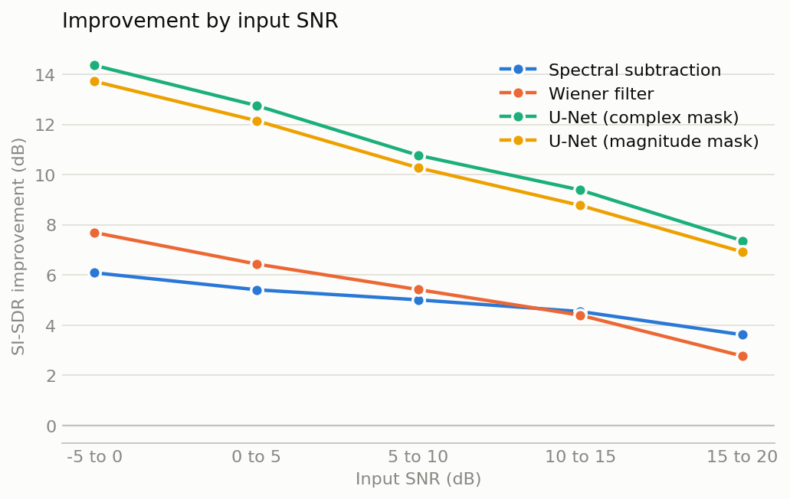
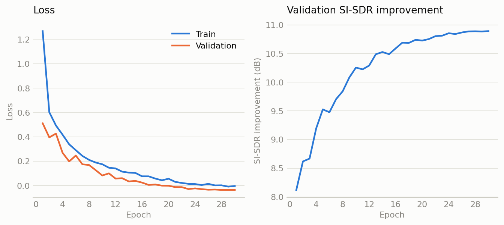
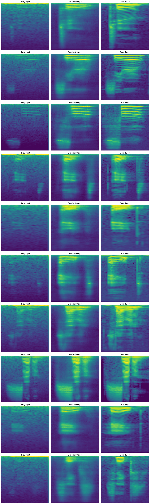

# Speech Denoising on AudioMNIST

[](https://github.com/mahdi-ahmadi-2002/Unet-Audiomnist-Denoiser/actions/workflows/ci.yml)


A single-channel speech enhancement system: an **attention U-Net that predicts a time-frequency mask on the STFT**, trained on spoken digits mixed with five kinds of noise at −5 to 20 dB SNR, and benchmarked against **classical DSP baselines** (spectral subtraction and a decision-directed Wiener filter) on **held-out speakers** with waveform-domain metrics.

**On 3,000 test utterances from six unseen speakers, the U-Net raises SI-SDR from 6.0 dB to 16.9 dB (+10.9 dB) and STOI from 0.883 to 0.947**, about twice the gain of the Wiener filter (+5.3 dB), while running roughly ten times faster than real time on a CPU.

> **Timeline.** First version built in September 2025 as a Kaggle notebook (mel-spectrogram U-Net, kept in [`notebooks/legacy/`](notebooks/legacy)). Reworked in November 2026 into the package described here: new model, loss, noise simulation, classical baselines, a speaker-independent evaluation and tests. [What changed and why](#from-the-original-notebook-to-this-version) is documented below.



*One test utterance per noise type. Columns: noisy input, Wiener filter, U-Net with complex mask, U-Net with magnitude mask, clean target.*

```
noisy waveform ─► STFT ─► attention U-Net ─► mask ─► mask × noisy STFT ─► inverse STFT ─► enhanced waveform
```

## What is in the repository

| Component | Description |
|---|---|
| Mask-based U-Net | Residual encoder/decoder with attention-gated skip connections. Fully convolutional, so it accepts audio of any length. |
| Two mask types | **Magnitude mask** (gain in [0, 1], noisy phase reused) and **complex mask** in polar form (gain plus a learned phase rotation). |
| Loss | Multi-resolution STFT loss plus a waveform SNR term that anchors polarity and scale. |
| Noise simulation | White, pink, brown, mains hum and multi-speaker babble, mixed on the fly at a random SNR. Pre-mixed `*_noisy.wav` pairs are also supported. |
| Classical baselines | Spectral subtraction and a Wiener filter with decision-directed a-priori SNR, both using a quantile-based noise estimator. No training needed. |
| Evaluation | SI-SDR, SI-SDR improvement, SNR, STOI and optional PESQ, broken down by noise type, input SNR and speaker group, plus parameter count and CPU real-time factor. |
| Tooling | YAML configs, training with warm-up + cosine schedule, early stopping and resume, a file/folder inference CLI, a Gradio demo, 54 unit and end-to-end tests, and CI. |

## Results

Test set: 3,000 utterances from six held-out speakers (500 each), every utterance mixed with one of five noise types at an SNR drawn uniformly from −5 to 20 dB. All systems are scored on exactly the same noisy signals, against the clean waveform.

| System | SI-SDR (dB) | SI-SDR improvement (dB) | SNR (dB) | STOI | Parameters | Real-time factor (CPU) |
|---|---:|---:|---:|---:|---:|---:|
| Noisy input | 6.00 | – | 5.71 | 0.883 | – | – |
| Spectral subtraction | 10.92 | +4.93 | 11.04 | 0.894 | – | 0.003 |
| Wiener filter | 11.33 | +5.33 | 11.56 | 0.886 | – | 0.013 |
| U-Net, magnitude mask | 16.35 | +10.36 | 16.62 | 0.947 | 9.07 M | 0.097 |
| **U-Net, complex mask** | **16.91** | **+10.92** | **17.19** | **0.947** | 9.07 M | 0.102 |

Higher is better for every metric except the real-time factor (processing time ÷ audio duration, measured on a desktop CPU for one-second clips; 0.1 means ten times faster than real time).

### By noise type



| Noise | Spectral subtraction | Wiener filter | U-Net, magnitude | U-Net, complex |
|---|---:|---:|---:|---:|
| White | +7.30 | +8.01 | +11.25 | +11.25 |
| Pink | +4.47 | +5.35 | +9.47 | +9.70 |
| Brown | +3.93 | +6.89 | +14.99 | +15.86 |
| Hum | +8.74 | +6.22 | +11.97 | +13.75 |
| Babble | +0.02 | −0.02 | +3.94 | +3.85 |

### By input SNR



| Input SNR (dB) | Spectral subtraction | Wiener filter | U-Net, magnitude | U-Net, complex |
|---|---:|---:|---:|---:|
| −5 to 0 | +6.09 | +7.69 | +13.72 | +14.36 |
| 0 to 5 | +5.41 | +6.44 | +12.15 | +12.76 |
| 5 to 10 | +5.01 | +5.41 | +10.27 | +10.77 |
| 10 to 15 | +4.54 | +4.39 | +8.77 | +9.39 |
| 15 to 20 | +3.61 | +2.77 | +6.92 | +7.36 |

### What the numbers say

- **The network roughly doubles the gain of classical processing.** +10.9 dB against +5.3 dB for the Wiener filter, and it is ahead in every noise type and every SNR band.
- **Intelligibility improves only with the network.** STOI goes from 0.883 to 0.947. The classical methods raise SNR but leave STOI almost unchanged (0.886 and 0.894).
- **Phase correction helps, modestly.** The complex mask is 0.56 dB ahead of the magnitude mask overall, with the largest margins on hum (+1.8 dB) and brown noise (+0.9 dB), both concentrated at low frequencies. On white noise and babble the two are level, and STOI is identical. This is one training run per model, so the overall margin should be read as indicative.
- **Babble is the hard case.** The classical methods give no improvement at all: their noise estimate assumes stationary noise, and the interference here is other people saying digits. The network still gains +3.9 dB, well below its gain on the other types.
- **Gains shrink as the input gets cleaner**, from +14.4 dB below 0 dB SNR to +7.4 dB above 15 dB: there is less noise left to remove.
- **Spectral subtraction beats the Wiener filter on hum** (+8.7 against +6.2 dB), the one condition where the simpler method wins.

### Speaker groups

For the complex-mask model, the improvement is +12.2 dB on the two female test speakers and +10.3 dB on the four male ones, and between +10.7 and +11.0 dB across the three accents present (German, Chinese, South Korean). With six test speakers these differences describe individual voices more than groups; the full tables are in [`results/results.md`](results/results.md).

### Training



Each model was trained for 30 epochs on 24,000 utterances from 48 speakers (5 to 6 hours on a GTX 1650 with 4 GB). Validation improvement was still rising slowly at the last epoch (+10.89 dB), so longer training would likely add a little.

### Listen

[`results/samples/`](results/samples) holds five test utterances, one per noise type, each as noisy input, both baselines, both U-Nets and the clean reference.

### Reproduce

```bash
python -m denoiser.train --config configs/unet_complex.yaml
python -m denoiser.train --config configs/unet_magnitude.yaml
python -m denoiser.evaluate --checkpoint runs/unet_complex/best.pt runs/unet_magnitude/best.pt
```

The test set is derived from fixed seeds, so the evaluation is deterministic: re-running it on the same checkpoints reproduced the accuracy figures above exactly. Not measured here: PESQ (supported with `--pesq`) and the no-attention ablation (`configs/unet_no_attention.yaml`).

## Quick start

```bash
git clone https://github.com/mahdi-ahmadi-2002/Unet-Audiomnist-Denoiser
cd Unet-Audiomnist-Denoiser
pip install -e ".[dev]"
pytest
```

### Data

[AudioMNIST](https://github.com/soerenab/AudioMNIST) contains 30,000 recordings of spoken digits from 60 speakers at 48 kHz.

```bash
git clone https://github.com/soerenab/AudioMNIST data/AudioMNIST
```

The default config expects `data/AudioMNIST/data/<speaker>/<digit>_<speaker>_<take>.wav`. To use another location, pass `--set data.root=/path/to/data`. To train on the pre-mixed Kaggle "Noisy AudioMNIST" pairs used by the original notebook instead of synthetic noise, use `configs/paired_kaggle.yaml`.

### Train

```bash
python -m denoiser.train --config configs/unet_complex.yaml
```

Any setting can be overridden from the command line, and a run can be resumed:

```bash
python -m denoiser.train --config configs/unet_complex.yaml --set train.epochs=10 train.batch_size=8
python -m denoiser.train --config configs/unet_complex.yaml --resume runs/unet_complex/last.pt
```

Each run folder holds `best.pt`, `last.pt`, `config.json`, `history.json` and `history.png`. On a GTX 1650 (4 GB) one epoch over the 24,000 training utterances takes about ten minutes. Mixed precision is used when the GPU supports it and is switched off automatically on cards that return NaN in half precision (the GTX 16xx series does).

### Denoise your own audio

```bash
python -m denoiser.infer noisy.wav -o clean.wav --checkpoint runs/unet_complex/best.pt
python -m denoiser.infer recordings/ -o cleaned/ --method wiener
```

Input can be any length and sample rate; it is resampled to 16 kHz and long files are processed in cross-faded chunks.

### Demo

```bash
pip install gradio
python app.py --checkpoint runs/unet_complex/best.pt
```

Upload or record speech, optionally add noise at a chosen SNR, and compare the U-Net with the classical methods by ear and by spectrogram.

## Method

### Front end

Audio is resampled to 16 kHz and padded or cropped to one second. The STFT uses a 512-sample Hann window with a 128-sample hop (257 bins × 126 frames). The input to the network is the power-law-compressed spectrum (`|X|^0.3`), which reduces the dynamic range between loud harmonics and quiet consonants. The waveform is normalised to unit RMS before the STFT and the gain is restored afterwards, so the result does not depend on recording level.

### Network

A four-level U-Net with 32 base channels (9.1 M parameters):

- **Residual blocks** (two 3×3 conv + batch norm) at every level.
- **Attention gates** on the skip connections (Oktay et al., 2018), so the decoder decides which encoder activations are passed across rather than copying noise through.
- **Bilinear upsampling followed by a convolution** rather than transposed convolutions, which avoids checkerboard artefacts.
- The input is padded to a multiple of 16 and cropped back, so any spectrogram size works without resizing.

### Masks

| | Output | Phase |
|---|---|---|
| Magnitude mask | `sigmoid` gain in [0, 1] per bin | The noisy phase is reused. |
| Complex mask | The same gain plus a rotation `π·tanh(·)` in [−π, π] | Corrected by the network. |

The rotation branch is initialised to zero, so the complex model starts as a magnitude mask and learns phase correction as a refinement. Both masks are bounded by 1, so no bin can come out louder than it went in.

### Loss

```
L = MRSTFT(ŝ, s) − 0.05 · SNR_dB(ŝ, s)
```

The multi-resolution STFT loss (spectral convergence + log-magnitude L1 at FFT sizes 256, 512 and 1024) penalises smeared transients and smeared harmonics at the same time. It is blind to phase, so a waveform SNR term is added. Plain SNR is used rather than SI-SDR because SI-SDR ignores sign and scale: in a smoke run, a complex-mask model trained with SI-SDR reached a high SI-SDR while its plain SNR was negative.

### Noise

| Type | How it is generated |
|---|---|
| White, pink, brown | Gaussian noise shaped in the frequency domain to a `1/f^α` spectrum (α = 0, 1, 2). |
| Hum | A 50 or 60 Hz fundamental with decaying harmonics and a faint noise floor. |
| Babble | Three to six overlapping utterances from other speakers in the same split. |

The SNR is drawn uniformly from [−5, 20] dB and is defined against the power of the utterance itself, not the zero-padded segment. Training draws fresh noise on every access; validation and test noise is fixed per utterance.

### Classical baselines

Both estimate the noise spectrum without a voice activity detector: the 30th percentile of each frequency bin's power over time, divided by `−ln(0.7)` (the ratio between that quantile and the mean of an exponential distribution) to make it an unbiased estimate of the noise power.

- **Spectral subtraction** (Berouti et al., 1979) with over-subtraction factor 2 and a spectral floor.
- **Wiener filter** with decision-directed a-priori SNR tracking (Ephraim & Malah, 1984), which suppresses the musical noise that plain subtraction leaves behind.

### Evaluation protocol

- **Speaker-independent split**: 48 / 6 / 6 speakers for train / validation / test, fixed by seed. No speaker appears in two splits.
- **Metrics are computed on waveforms** against the clean reference: SI-SDR and its improvement over the noisy input, SNR, STOI (intelligibility) and optionally PESQ (`pip install pesq`, then `--pesq`).
- STOI needs about 0.4 s of active speech; shorter digits are excluded from the STOI average only.
- With six test speakers, the per-group breakdown (gender, accent, age) is indicative only; the tables report how many speakers each group contains.

## From the original notebook to this version

The project began in September 2025 as a Kaggle notebook (kept in [`notebooks/legacy/`](notebooks/legacy)) that trained a U-Net to map noisy log-mel spectrograms to clean ones. Reviewing it surfaced several issues, each of which this version addresses:

| Issue in the notebook | Consequence | Fix |
|---|---|---|
| "SNR" was computed between min-max-normalised mel-spectrogram images. | The reported 7.67 → 14.66 dB is a spectrogram-pixel score, not an audio SNR. | All metrics are computed on waveforms. |
| Each spectrogram was normalised with its own min/max, and the output was de-normalised with the **clean** file's values. | Reconstruction used information that is unavailable at inference time. | Normalisation uses only the noisy input and is exactly invertible. |
| Files were split at random. | The same 60 speakers appeared in train and test. | Speaker-independent split. |
| Spectrograms were resized to 128×100 with spline interpolation. | The time axis was warped, so audio could not be reconstructed faithfully. | Fixed-length waveforms, native STFT resolution. |
| Audio was recovered from mel spectrograms with Griffin-Lim. | Phase was estimated from scratch, giving audible artefacts. | A mask is applied to the noisy STFT and inverted directly. |
| Trained for one epoch, with no baseline. | No evidence the network beat simple signal processing. | 30 epochs with validation-based checkpointing, compared against two classical baselines. |

Output of the September 2025 notebook, for reference (1 epoch, log-mel MSE 0.0052):



## Repository layout

```
denoiser/
  config.py      typed configuration (YAML + command-line overrides)
  audio.py       I/O, resampling, STFT, noise synthesis, SNR mixing, chunked processing
  data.py        dataset discovery, speaker-independent split, noisy/clean dataset
  model.py       attention U-Net and the waveform-to-waveform Denoiser
  losses.py      SNR, SI-SDR, multi-resolution STFT loss
  baselines.py   spectral subtraction, Wiener filter, noise estimator
  metrics.py     STOI and PESQ wrappers
  train.py       training loop
  evaluate.py    benchmark, tables, figures, listening samples
  infer.py       file / folder inference
  viz.py         figures
app.py           Gradio demo
configs/         main model, ablation variants, paired-data variant
results/         metrics, tables, figures and listening samples from the reported run
tests/           54 tests, including an end-to-end train → evaluate → infer run
notebooks/legacy original Kaggle notebooks
```

## Limitations

- Trained on isolated digits with simulated noise. Real recordings contain reverberation, non-stationary noise and continuous speech, which this setup does not cover.
- The model works at 16 kHz, so content above 8 kHz in the 48 kHz originals is discarded.
- The network sees the whole one-second segment, so it is not causal; a streaming version would need causal convolutions and normalisation.
- Babble noise is built from other AudioMNIST speakers saying digits, which is the hardest condition: the interference is the same kind of signal as the target.

## References

- Ronneberger, Fischer, Brox. *U-Net: Convolutional Networks for Biomedical Image Segmentation.* MICCAI 2015.
- Oktay et al. *Attention U-Net: Learning Where to Look for the Pancreas.* MIDL 2018.
- Williamson, Wang, Wang. *Complex Ratio Masking for Monaural Speech Separation.* IEEE/ACM TASLP 2016.
- Yamamoto, Song, Kim. *Parallel WaveGAN.* ICASSP 2020 (multi-resolution STFT loss).
- Le Roux, Wisdom, Erdogan, Hershey. *SDR – Half-baked or Well Done?* ICASSP 2019.
- Berouti, Schwartz, Makhoul. *Enhancement of Speech Corrupted by Acoustic Noise.* ICASSP 1979.
- Ephraim, Malah. *Speech Enhancement Using a Minimum Mean-Square Error Short-Time Spectral Amplitude Estimator.* IEEE TASSP 1984.
- Stahl, Fischer, Bippus. *Quantile Based Noise Estimation for Spectral Subtraction and Wiener Filtering.* ICASSP 2000.
- Taal, Hendriks, Heusdens, Jensen. *An Algorithm for Intelligibility Prediction of Time-Frequency Weighted Noisy Speech.* IEEE TASLP 2011.
- Becker et al. *AudioMNIST: Exploring Explainable Artificial Intelligence for Audio Analysis on a Simple Benchmark.* Journal of the Franklin Institute, 2024.

## License

MIT. See [LICENSE](LICENSE).
