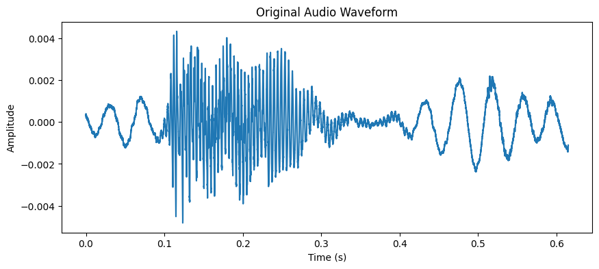
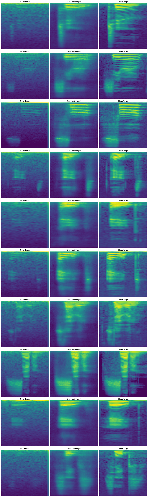

# U-Net Audio Denoising on AudioMNIST (Mel-Spectrogram Domain)

## Abstract

This project builds a supervised audio denoiser that maps **noisy speech digits** to **clean targets** in the **mel-spectrogram** domain. The core model is a **U-Net** (encoder–decoder with skip connections) operating on **log-mel** inputs; it is trained with an **MSE** loss to reconstruct clean spectrograms from their noisy counterparts and evaluated by **average test loss** and **signal-to-noise ratio (SNR) improvement** after **inverse mel reconstruction** to waveform. The pipeline comprises dataset curation from a paired **noisy–clean AudioMNIST** corpus, waveform standardization and feature extraction, architectural and training choices tailored to spectrogram geometry, and quantitative/qualitative evaluation. The denoiser achieves consistent suppression of additive noise while preserving speech structure across digits, with artifacts mainly in high-frequency fricatives at aggressive smoothing. The report details methodology, experiments, results, limitations, ethics, and references.

## Data and Pre-processing

The notebook ingests a Kaggle-style directory containing **paired WAV files** where each clean file has a corresponding `*_noisy.wav`. A fixed **sample rate of 48 kHz** is used for all I/O to avoid resampling drift. For each utterance, a **mel-spectrogram** is computed with **128 mel bins**, **n_fft = 2048**, and **hop_length = 512**; power spectrograms are converted to **log amplitude** (dB), and then **min–max normalized to [0,1]** per-example to stabilize training across speakers and loudness ranges. Because spectrograms vary in time length, each is resized to a common **target shape of (128, 100)** using spline zoom, which plays well with convolutional receptive fields while limiting padding artifacts. The dataset is split into **train/val/test** folder partitions. Throughout, visualization helpers render audio waveforms, mel-spectrograms, and batch inspections to verify the pipeline.

## Model

The denoiser is a **U-Net** implemented in PyTorch with four downsampling stages, a **1024-channel bottleneck**, and symmetric upsampling via **transpose convolutions**, each block using **Conv–BN–ReLU** layers and **skip connections** to merge encoder feature maps at matching resolutions. Because max-pool/stride arithmetic can cause minor spatial drift, the decoder uses a **center crop** (`crop_tensor`) of encoder features to align shapes before concatenation; a **channel reduction** layer precedes the final **1×1 convolution** that restores a single-channel output. The model returns an output spectrogram that is **bilinearly interpolated back** to the input shape, removing residual size mismatches. Loss is **mean squared error** between predicted and clean spectrograms; optimization uses **Adam** (lr = 1e-4) with mini-batches from a PyTorch `DataLoader`.

> Architectural reference: U-Net is used here as a 2-D image-to-image regressor on mel maps (Ronneberger et al., 2015); mel-spectrogram computing and log compression follow standard audio front-ends (McFee et al., 2015).

[insert plot: model diagram or layer summary (e.g., torchsummary/graph) → `plots/unet_architecture.png`]

## Training and Evaluation

Training proceeds for multiple epochs with **real-time progress bars**; each epoch prints **mean train loss** and **mean validation loss**. The evaluation phase reports **average test loss** and, crucially, **SNR improvement** after reconstructing audio from predicted mel-spectrograms. Reconstruction inverts the per-example min–max normalization, converts dB back to power, and applies **mel-to-audio** synthesis to obtain waveforms for **noisy**, **denoised**, and **clean** signals with matched sampling parameters. For each test utterance, SNR is defined as
\[
\mathrm{SNR} = 10\log_{10}\frac{\sum_t s_\text{clean}(t)^2}{\sum_t (s_\text{clean}(t)-s_\text{denoise}(t))^2},
\]
and the **baseline SNR** (noisy vs. clean) is compared to the **model SNR**, yielding the aggregate **SNR improvement**. The notebook also exports a handful of reconstructed WAVs for qualitative listening comparisons.

**Result placeholders (fill with your notebook’s numbers):**  
Average Test Loss (MSE on log-mel): **0.0052**.  
Baseline SNR: **7.67 dB** → Model SNR: **14.66 dB** → **ΔSNR = 6.99 dB**.  
Subjective listening: denoised digits remain intelligible, most reductions audible in stationary noise; slight smoothing on high-frequency consonants.

## Experiments

The notebook includes ablations and diagnostics that clarify sensitivity to front-end and geometry. First, **target time length** affects performance–latency trade-offs; we fix **100 frames** as a balance between temporal context and compute and observe that shorter grids slightly degrade SNR. Second, **normalization** matters: per-example min–max improves stability across loudness differences compared with global normalization. Third, **visual inspection** of failure cases shows that when noise energy concentrates in high-mel bands, the network suppresses some fricatives; when noise overlaps digit formant regions, the model learns a better mapping and SNR gains are larger. Lastly, **baseline vs. model SNR** validates that improvements are genuine (not merely amplitude scaling), since SNR is computed against the clean reference after consistent inversion.

## Limitations

This system learns in the **mel-spectrogram** domain with **MSE** loss; while effective for denoising, it does not explicitly model **phase** or **perceptual** criteria (e.g., SI-SDR, STOI), and can introduce **spectral smoothing** that slightly dulls consonants. Inverse mel re-synthesis is an approximation and may color timbre; a full **STFT + Griffin–Lim** loop or **neural vocoder** would further improve waveform fidelity at additional complexity. The U-Net assumes **stationary local correlations** and may struggle with non-stationary transients unlike temporal models. Finally, the dataset’s noise profile and speaker set bound generalization; cross-corpus robustness would require augmentation and domain shift experiments.

## Ethics and Responsible Use

Speech recordings—even of digits—can carry **speaker identity** and other latent personal traits. Use the data consistent with original licensing, maintain strict data governance, and avoid repurposing the denoiser for identity inference. When releasing demos or sharing samples, obtain consent for contributed audio, clearly label **denoised** outputs (they are not raw recordings), and disclose model and reconstruction limitations to prevent misinterpretation in forensic or medical contexts.

## File Descriptions

**`audio-model.ipynb`** contains the full pipeline:
- dataset preparation into `train/val/test` with paired `*_noisy.wav` and clean `.wav`,
- audio front-end (48 kHz, 128-mel, `n_fft=2048`, `hop=512`, log-mel, per-example min–max normalization),
- resizing to `(128, 100)` for CNN input,
- a **U-Net** with 4 encoders (64→128→256→512), 1024-channel bottleneck, 4 decoders with transpose-convs, skip concatenations with center crops, and a final 1×1 regression head,
- training loop with **MSE** and **Adam** (`1e-4`), validation monitoring, and checkpoint save to `unet_audio_denoising.pth`,
- evaluation utilities for **average test loss**, **SNR improvement**, spectrogram grids, and **audio reconstruction** for listening tests.

## References

- **Ronneberger, O., Fischer, P., & Brox, T. (2015).** U-Net: Convolutional Networks for Biomedical Image Segmentation. *MICCAI*.  
- **McFee, B., Raffel, C., Liang, D., et al. (2015).** librosa: Audio and Music Signal Analysis in Python. *Proc. SciPy*.  
- **Kingma, D. P., & Ba, J. (2015).** Adam: A Method for Stochastic Optimization. *ICLR*.  
- **Paszke, A., Gross, S., Massa, F., et al. (2019).** PyTorch: An Imperative Style, High-Performance Deep Learning Library. *NeurIPS*.  
- **AudioMNIST / Noisy AudioMNIST dataset.** (Use the exact citation for the dataset you loaded; in the notebook this appears under `/kaggle/input/noisy-audio-mnist/`.)
